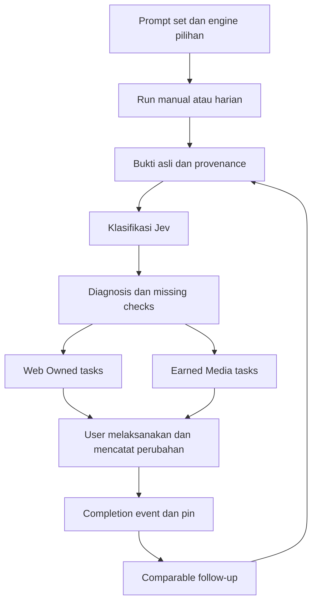
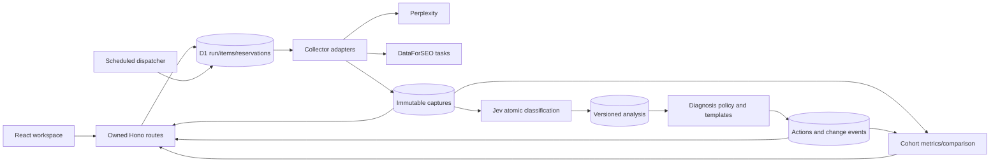
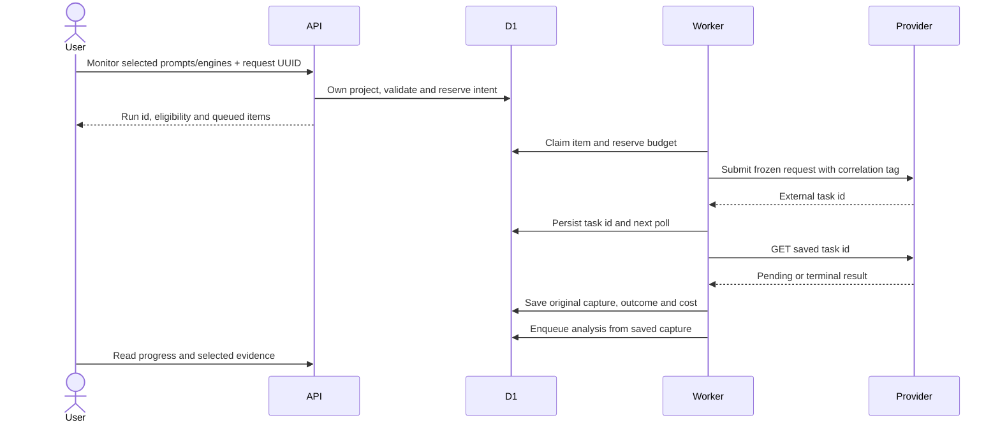
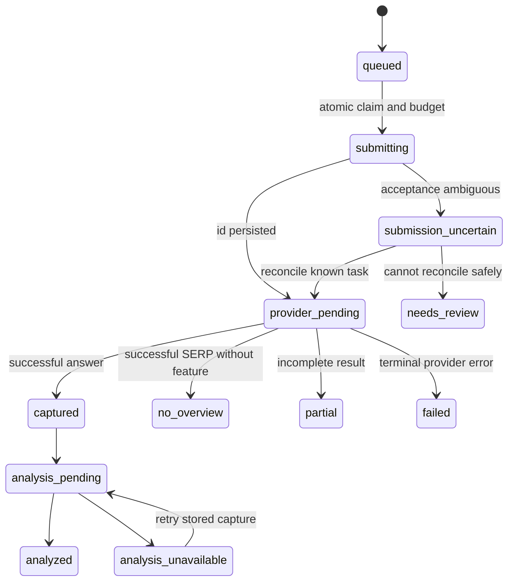
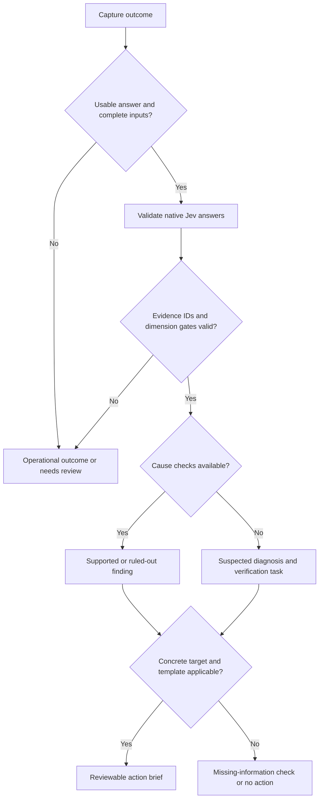
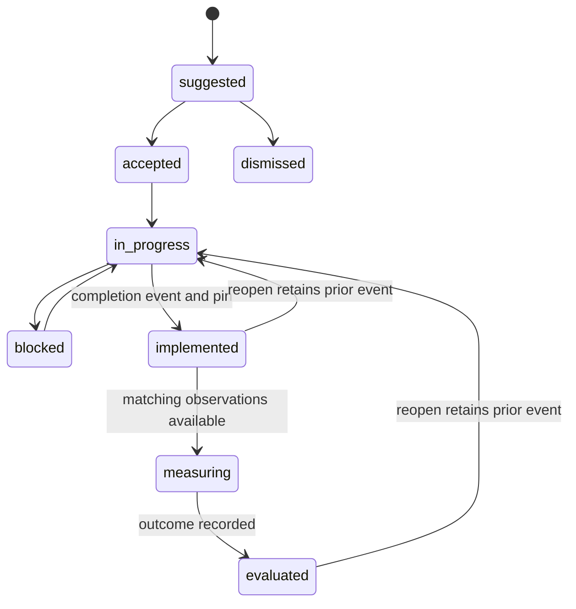
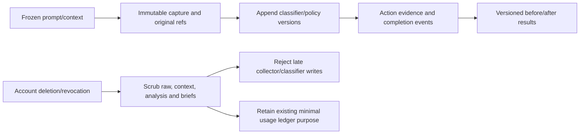
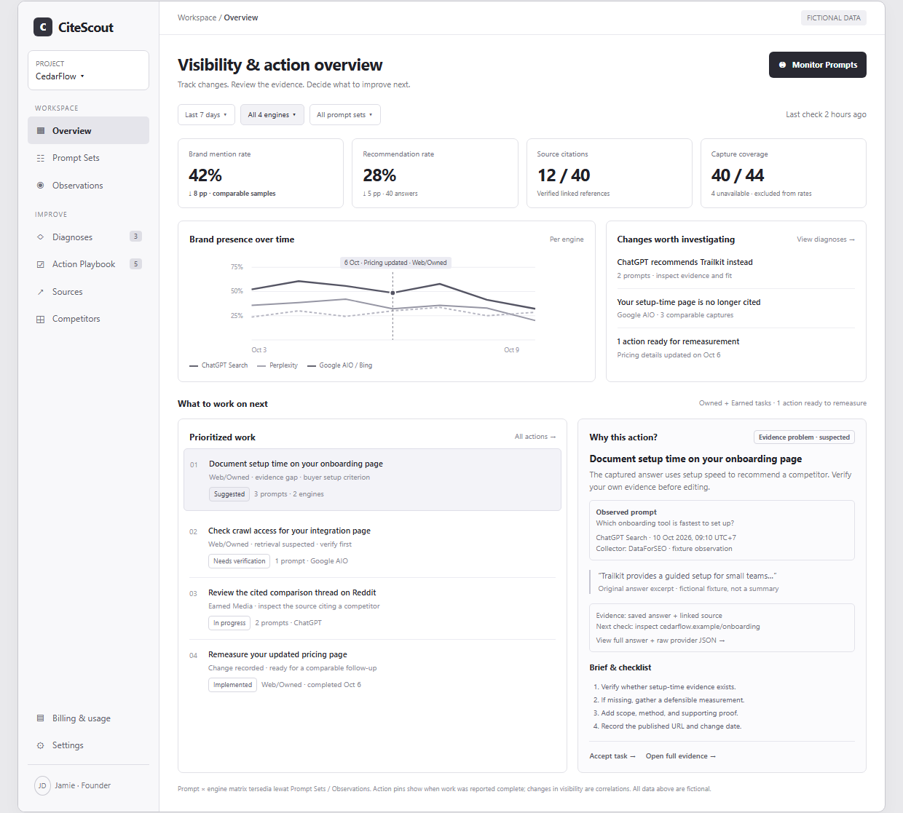

# CiteScout GEO Action Loop - Plan

## Goal Capsule

- **Objective:** Founder dan tim marketing dapat mengubah observasi visibilitas AI menjadi pekerjaan yang berbukti, mencatat pelaksanaannya, dan meninjau hasil pengukuran ulang.
- **Means:** Multi-engine observation, klasifikasi Jev, diagnosis, Action Playbook, dan dashboard profesional (KTD1–KTD8).
- **Product authority:** Scope dan layout campuran disetujui pengguna pada 10 Oktober 2026, termasuk transparansi bukti, pekerjaan Owned/Earned, dan action pins.
- **Open blockers:** Tidak ada keputusan produk yang menahan penulisan plan; akses provider, hasil evaluasi classifier, dan biaya nyata merupakan prasyarat aktivasi produksi.
- **Execution boundary:** Dokumen ini merencanakan perubahan; implementasi, transaksi provider, migrasi remote, dan deployment bukan hasil yang telah dikerjakan.

---

## Product Contract

### Summary

CiteScout menghubungkan prompt set, observasi empat surface AI, klasifikasi, diagnosis, pekerjaan konkret dan pengukuran ulang.
Dashboard memadukan ringkasan/tren dengan pekerjaan dan bukti asalnya.
Pengguna melaksanakan pekerjaan di website atau tools sendiri.

### Problem Frame

V2 mengalihkan Overview ke Questions dan mengganti sidebar dengan navigasi header sederhana.
Pengguna kehilangan akses monitoring yang mudah ditemukan dari dashboard.
Arsip jawaban dan mention belum memberi alur yang utuh untuk memilih pekerjaan dan kembali menilai hasilnya.

### Key Decisions

- **Founder/marketing dahulu.** Dipilih sebelum agency dan brand/e-commerce untuk melayani pekerjaan brand sendiri (session-settled: user-directed — chosen over agency/e-commerce now: fokus pengguna fase awal). Governs R1.
- **Tugas, checklist dan brief.** Pengguna bekerja di tools sendiri (session-settled: user-directed — chosen over generated drafts and auto-publishing: menuntaskan loop dengan pelaksanaan manual). Governs R17, R18.
- **Bing Copilot Answers.** Surface Copilot awal memakai hasil di Bing (session-settled: user-directed — chosen over Copilot chat app: jalur observasi DataForSEO sudah tersedia). Governs R6.
- **Dashboard campuran.** Ringkasan/tren dan pekerjaan/bukti sama-sama terlihat (session-settled: user-directed — chosen over visibility-only and action-only layouts: kedua kebutuhan tetap hadir). Governs R2, R3, R8.
- **Manual dan harian.** Engine dipilih pengguna (session-settled: user-directed — chosen over weekly and manual-only: monitoring berkala dengan akses manual). Governs R4, R5, R21.
- **Bukti asli, Owned/Earned dan pins.** Tambahan pengguna diterima bersama batas metodologinya (session-settled: user-approved — chosen over opaque scores and unqualified ROI attribution: bukti terlihat dan before/after dibaca sebagai korelasi). Governs R8, R9, R15, R16, R19, R20.

### Actors

- A1. Founder/marketing sebagai pemilik satu proyek/account pada fase awal.
- A2. Sistem pengumpul observasi, classifier, policy diagnosis dan scheduler.
- A3. Operator mengatur integrasi, anggaran dan aktivasi layanan.

### Requirements

**Workspace and monitoring**

- R1. Fase awal melayani founder/marketing dengan satu proyek/account mengikuti app saat ini; undangan anggota, multi-client agency dan workflow khusus e-commerce ditunda.
- R2. Main app mempunyai sidebar profesional dengan Overview, Prompt Sets, Observations, Diagnoses, Action Playbook, Sources, Competitors, Billing/Usage dan Settings; navigasi mobile menggunakan drawer yang dapat dioperasikan dengan keyboard.
- R3. Overview menampilkan filter proyek/periode/engine, ringkasan dengan coverage, tren dan perubahan utama, lalu pekerjaan prioritas dengan bukti/brief observasi terpilih; matriks prompt × engine dapat dibuka di Prompt Sets/Observations.
- R4. Tombol Monitor Prompts terlihat dari Overview dan mendukung check manual serta jadwal otomatis harian untuk engine yang dipilih pengguna.
- R5. Manual check yang diterima menghasilkan observasi baru dalam kuota/cooldown; replay request yang sama tidak membuat biaya baru dan job harian tidak menghapus kebutuhan manual.
- R6. Surface awal adalah Perplexity Agent API, Google AI Overview, ChatGPT Search dan Bing Copilot Answers, dengan collector/surface yang dilabeli secara tepat.

**Evidence and measurement**

- R7. Setiap observasi menyimpan prompt riil yang dikirim, versi prompt/konteks, engine/surface/collector, konfigurasi lokasi/bahasa/device yang tersedia, timestamp run dan capture, serta provenance model yang tersedia.
- R8. Panel bukti Overview selalu memperlihatkan prompt terkirim, engine, timestamp dan kutipan asli observasi terpilih; jawaban lengkap serta raw provider JSON tersedia lewat detail observasi dan raw download.
- R9. Setiap metrik/diagnosis menjelaskan scope, periode, denominator, coverage dan metode, dengan akses ke observasi pendukung; skor gaib 0–100 tidak digunakan.
- R10. Returned search results, displayed answer references dan citation links dibedakan sesuai capability provider; linkage ke span teks tidak dikarang bila provider tidak menyediakannya.
- R11. Jev mengevaluasi pertanyaan semantik atomik tentang answer quality, brand presence/stance, recommendation fit, evidence support, alasan pemilihan/penolakan dan source type, dengan probabilitas/confidence native yang dapat diaudit.
- R12. Capture gagal, overview tidak muncul, parsing parsial, classifier unavailable dan klasifikasi uncertain mempunyai state eksplisit; kondisi tersebut tidak dipaksa menjadi brand absence atau diagnosis optimasi.
- R13. Diagnosis retrieval, evidence dan recommendation-fit dapat muncul bersama atau tidak muncul, dengan status suspected/supported/unknown, bukti dan pemeriksaan yang masih diperlukan; teks jawaban saja tidak membuktikan akar masalah retrieval.
- R14. Capture asli dan konteks historis tetap tersedia ketika prompt, engine, source ownership atau classifier berubah; hasil turunan baru tidak menulis ulang bukti lama.

**Action loop**

- R15. Setiap action dilabeli Web/Owned atau Earned Media, dan masalah/asset yang sama dapat digabung menjadi satu pekerjaan dengan seluruh scope/bukti terkait.
- R16. Earned Media tasks menunjuk URL/platform dan kaitan sumber terhadap jawaban/kompetitor yang teramati, dengan frekuensi dan periode observasi yang nyata; rasio Owned/Earned dihitung per proyek tanpa patokan 40/60.
- R17. Action berisi judul konkret, reason, bukti, target, checklist, deliverable, prioritas beserta alasan, effort, status dan kriteria selesai; app tidak membuat draft konten panjang atau mempublikasikan pekerjaan.
- R18. Pengguna menerima/menolak pekerjaan, mencatat progres dan penyelesaian beserta URL/deskripsi perubahan serta waktu implementasi yang dilaporkan, dan dapat membuka kembali pekerjaan tanpa kehilangan catatan sebelumnya.
- R19. Completion membuat pin/annotation pada tren yang menghubungkan action, label pekerjaan, waktu dan affected prompt/engine dengan bukti awal serta follow-up; timestamp pin membedakan completion dari waktu implementasi yang dilaporkan.
- R20. Pengukuran ulang membandingkan observasi pada scope/konteks/metode yang sebanding, menampilkan improved/unchanged/worsened/inconclusive beserta sample/coverage, dan tidak mengklaim kausalitas atau ROI finansial dari pin saja.

**Trust and continuity**

- R21. Manual, scheduled checks, retries, klasifikasi dan page checks mempunyai anggaran/cost accounting server-side yang transparan; harga/kuota final ditetapkan setelah biaya nyata dievaluasi, bukan otomatis menyalin limit V2 ke empat engine.
- R22. Migrasi mempertahankan riwayat V1/V2, penggunaan sebelumnya, trial/billing/access yang sah dan raw download; trial yang sudah berjalan mempertahankan konteks dan janji follow-up yang dibekukan.
- R23. API, evidence download, diagnosis, action dan pins memeriksa kepemilikan tenant; secrets tetap server-side dan teks/URL sumber diperlakukan sebagai input tidak tepercaya.
- R24. Loading, empty, queued/running, partial, stale, quota/cooldown, failed dan needs-review states menyediakan penjelasan/langkah berikut; tindakan utama tidak menghilang hanya karena saat itu tidak dapat dijalankan.
- R25. Kualitas classifier dievaluasi per dimensi/engine pada jawaban yang dilabeli manusia, termasuk input adversarial, dan latency/cost diukur dari workload nyata; target kurang dari 50 ms belum dijanjikan.
- R26. Observasi memakai prompt netral; informasi brand, kompetitor dan fakta produk diberikan pada post-processing dan tidak diam-diam disisipkan ke query pengukuran.
- R27. Kegagalan Jev atau policy diagnosis tidak menghapus capture yang berhasil dan tidak memicu pengumpulan jawaban berbayar ulang; processing turunan dapat dilanjutkan dari capture tersimpan.

### Key Flows

- F1. **Configure and activate.** A1 memilih prompt dan engine lalu meninjau konfigurasi/rencana check; A2 mempertahankan konteks trial lama bila masih aktif. Covers R4, R6, R7, R21, R22, R26.
- F2. **Observe and inspect.** A1 menekan Monitor Prompts atau scheduler membuat run; A2 mengumpulkan hasil per engine, menampilkan progress, lalu menyajikan jawaban asli dan processing turunan. Covers R5, R8, R10, R12, R24, R27.
- F3. **Diagnose and act.** A1 meninjau bukti, pemeriksaan yang diperlukan dan pekerjaan Owned/Earned, kemudian menerima tugas dan menjalankannya di luar app. Covers R11, R13, R15, R16, R17.
- F4. **Complete and remeasure.** A1 mencatat perubahan dan menyelesaikan pekerjaan; A2 menambahkan pin, mengumpulkan follow-up dan menyajikan comparison yang sebanding. Covers R14, R18, R19, R20.



### Acceptance Examples

- AE1. **Covers R6, R12, R24, R27.** Tiga engine berhasil dan satu gagal: ketiga jawaban tetap tersedia, kegagalan ditunjukkan terpisah, dan error tidak menurunkan mention rate seolah brand absen.
- AE2. **Covers R8, R10, R14.** User membuka diagnosis: prompt riil, engine, timestamp dan original excerpt terlihat; sumber yang hanya returned tidak diberi label citation, dan raw download menyajikan envelope provider tersimpan dengan provenance yang tepat.
- AE3. **Covers R11, R13, R25.** Brand tidak muncul dan page checks belum tersedia: retrieval hanya suspected/unknown, app menyarankan pemeriksaan, dan Jev tidak mengarang kondisi robots atau indeks.
- AE4. **Covers R5, R21.** Double-click/retry POST yang sama menghasilkan satu run/reservation; manual request baru setelah job harian dapat menghasilkan capture baru ketika quota/cooldown mengizinkan.
- AE5. **Covers R15, R16, R17.** Sebuah thread ditemukan berulang dalam jawaban yang merekomendasikan kompetitor: Earned Media task menunjukkan URL, periode, engine, jumlah observasi dan kekuatan kaitannya; frekuensi sumber returned-only tidak disamakan dengan verified citation.
- AE6. **Covers R18, R19.** Action selesai pada tanggal 10, dengan implementasi dilaporkan tanggal 9: pin menunjukkan kedua waktu, menautkan change record, dan event completion tetap dapat diaudit setelah action dibuka kembali.
- AE7. **Covers R14, R19, R20.** Prompt atau engine selection berubah antara action dan follow-up: grafik menjelaskan baseline/scope baru dan comparison yang tidak sebanding; pin tidak dipakai untuk mengklaim uplift.
- AE8. **Covers R20.** Sesudah pin tanggal 10 terdapat kenaikan metrik tanggal 17: UI menampilkan perubahan, periode, denominator dan coverage tanpa menyebutnya bukti ROI atau kausalitas.
- AE9. **Covers R22, R23.** User lama tetap dapat melihat history/trial/billing setelah migrasi; user lain tidak dapat membaca observation, raw JSON, action atau completion event miliknya.
- AE10. **Covers R2, R3, R24.** Desktop menampilkan sidebar dan workspace campuran; mobile/keyboard dapat membuka navigation, memulai monitoring, membaca bukti, serta menyelesaikan action tanpa hover-only controls.

### Success Criteria

- Founder dapat menyelesaikan F2–F4 dengan data nyata dan menemukan bukti untuk setiap diagnosis serta action yang dipilih.
- Pilot merekam waktu menuju diagnosis berguna pertama, accepted/implemented actions dan kunjungan untuk meninjau follow-up; angka tersebut menguji nilai produk dan bukan klaim validasi pasar yang sudah tercapai.
- Semua AE dipenuhi dengan fixtures dan pemeriksaan end-to-end yang sesuai; latency, quality dan cost report R25 tersedia sebelum diagnosis otomatis dipromosikan sebagai andal.

### Scope Boundaries

**Deferred:** Agency/multi-client, undangan anggota, workflow e-commerce, aplikasi chat Copilot, draft konten, auto-publishing, outbound messaging dan analytics/revenue attribution.

**Considered and not built:** Skor gabungan 0–100 karena mengaburkan metode; rasio universal sumber karena bergantung prompt/engine; causal/ROI engine karena belum ada data/experiment yang mendukung; browser scraping sendiri karena collector untuk surface yang dipilih tersedia.

### Dependencies and Outstanding Questions

- **Resolve Before Planning:** Tidak ada.
- **Planning resolutions:** Kontrak task collector, uniqueness/idempotency, comparability, action/events dan metode metrik ditetapkan di KTD2–KTD8.
- **Deferred to Implementation:** Validasi credential/sandbox, capture nyata tiap surface, ukuran payload, threshold classifier dari gold set, biaya p50/p95 serta harga/kuota yang layak. Kegagalan prasyarat live tidak membenarkan fixture fallback produksi.

### Sources and Research

- `research/geo-action-loop-design-draft.md`: diskusi dan pemetaan awal; Product Contract dokumen ini menjadi authority scope yang disetujui.
- `src/client/App.tsx`, `src/client/pages/v2/Workspace.tsx`, `src/client/pages/AppShell.tsx`: routes aktif, conditional scan CTA, pola sidebar lama.
- `src/shared/evidence.ts`, `src/domain/evidence.ts`, `src/server/v2/scans.ts`, `src/db/schema.ts`: capture/context/comparison dan scan accounting yang harus diperluas.
- `docs/citescout-v2-implementation.md`, `docs/citescout-v2-operations.md`, `docs/dogfood.md`: baseline/trial, rollout dan batas validasi lama.
- [TypeSafe primitives](https://docs.typesafe.ai/introduction), [quick start](https://docs.typesafe.ai/introduction/quickstart), [latency claim](https://typesafe.ai/blog/introducing-system-one-models-and-jev): typed answers, pertanyaan independen dan klaim vendor 70–500 ms.
- [Google SERP Advanced](https://docs.dataforseo.com/v3/serp/google/organic/live/advanced/), [ChatGPT LLM Scraper](https://docs.dataforseo.com/v3/ai_optimization-chat_gpt-llm_scraper-overview/), [Bing Copilot Answers](https://dataforseo.com/help-center/accessing-data-from-new-elements-of-bing-copilot-ai-overviews): surface pengumpulan yang dipilih.
- [Google Search Central](https://developers.google.com/search/docs/appearance/ai-features): fondasi crawl/index dan konten; tidak ada special schema tambahan untuk AIO.
- [BuzzStream study](https://www.buzzstream.com/blog/ai-citation-prompt-type-study/): sekitar 40% owned pada slice brand-awareness dalam dataset studi, dengan distribusi berbeda pada prompt lain; tidak dipakai sebagai bobot tetap.
- [NN/g progressive disclosure](https://www.nngroup.com/articles/progressive-disclosure/) dan [data-table tasks](https://www.nngroup.com/articles/data-tables/): pekerjaan utama mudah ditemukan dan detail dapat diinspeksi.

## Planning Contract

### Key Technical Decisions

- KTD1. **Perluas React/Hono/Workers/D1 yang ada.** V2 tetap menjadi authority workspace, access dan billing; gunakan pola sidebar lama, UI primitives, Recharts dan evidence helpers yang sudah terpasang. Tidak ada framework rewrite atau collector lewat browser sendiri. Implements R2, R3, R22.
- KTD2. **Pisahkan engine, surface dan collector.** Perplexity mempertahankan integrasi saat ini; tiga surface tambahan memakai DataForSEO Standard tasks yang dipersist. Native Workers `fetch` cukup untuk DataForSEO dan satu endpoint TypeSafe, dengan Zod yang sudah ada sebagai boundary validator. Implements R6, R7, R10, R27.
- KTD3. **Run manual fresh mempunyai identitas sendiri.** Daily intent tetap unik per proyek, hari UTC dan snapshot; manual memakai request UUID dengan payload hash. Item/result unik per run × prompt-version × engine/surface; reservation mengikat logical item/attempt, bukan hanya prompt/hari. Cooldown awal lima menit per prompt/engine dan in-flight exclusion ditegakkan atomik bersama quota. Implements R4, R5, R21.
- KTD4. **Bukti asli immutable; hasil turunan append/versioned.** Persist parsed provider JSON, original text parts dan frozen request context. Simpan classification, diagnosis serta action evidence references terpisah. Semantik quote berasal dari candidate span IDs, dan provenance dipastikan lewat lookup/offset pada teks asli. Implements R8, R10, R14, R23.
- KTD5. **Jev atomik; diagnosis dan brief memakai policy/template.** Pin `jev-1.13.0`, record model returned, rubric dan input hash. Choice/Score/Noul tidak saling membaca jawaban dalam satu call. Tidak ada generative model tambahan untuk brief. Implements R11, R13, R17, R25.
- KTD6. **Comparability berversi per surface.** Reported model yang berubah tetap memutus seri; surface yang memang tidak melaporkan model dapat dibandingkan pada konfigurasi sama dengan label keterbatasan. Metadata model yang tiba-tiba hilang pada surface yang biasanya melaporkan model menjadi inconclusive. Implements R7, R14, R20.
- KTD7. **Action mempunyai lifecycle dan completion event terpisah.** Deduplication menggabungkan pekerjaan asset/issue yang sama; status action dan outcome measurement berbeda. Completion menciptakan event immutable, baseline reference dan pin, tanpa otomatis membuat capture tambahan berbayar. Implements R15–R20, R21.
- KTD8. **Metrik memakai sampel dan coverage yang terlihat.** Cohort prompt-version/engine/configuration tetap; successful observation eligible pertama per pasangan per hari UTC dibekukan agar manual checks berikutnya tidak mengganti sampel berdasarkan hasil. Window before/after awal tujuh hari masing-masing, dengan periode partial ditandai. Implements R9, R16, R20.

### Assumptions and Release Prerequisites

Implementasi lokal dan fixtures dapat dimulai tanpa akses berbayar. Aktivasi engine produksi memerlukan credential, contoh capture nyata, validasi billing/status/task recovery dan dukungan lokasi dari account yang dipakai. Ini release gates, bukan alasan mengganti observasi nyata dengan demo.

Cooldown lima menit, polling lima menit dan window tujuh hari adalah default implementasi yang dapat dievaluasi dari pilot; bukan janji latensi, recrawl atau uplift. Nilai kuota/harga empat engine belum ditentukan. Pertahankan access paket lama, tetapi jangan mengaktifkan empat-engine daily fan-out sebelum observation/cost budget baru dikonfigurasi operator.

Jev tidak menjamin <50 ms end-to-end. Versi 1.13 juga dapat dipengaruhi instruksi dalam state; pemisahan trusted rubric dari answer text tidak menjadi jaminan keamanan. Semua hasil adalah saran yang dapat ditinjau, tanpa tools eksekusi, publikasi atau messaging. [Model limitations](https://docs.typesafe.ai/model-jaggedness/jev-1.13), [confidence semantics](https://docs.typesafe.ai/confidence), [API](https://docs.typesafe.ai/api).

### High-Level Technical Design

Sketsa berikut menetapkan batas komponen dan alur. Implementer tetap memeriksa detail helper serta schema saat mengerjakan unit; diagram bukan kode siap salin.

**Components and data flow**



**Collector protocol**



**Collection state and analysis decisions**





**Action lifecycle and storage lifecycle**





**API surface and activation modes**

| Route family                        | Reads / mutations                                                             | Trust boundary                                      |
| ----------------------------------- | ----------------------------------------------------------------------------- | --------------------------------------------------- |
| Existing V2 project/questions       | Add prompt-set grouping, selected engine/configuration, eligibility           | Session owner; preserve frozen active trials        |
| Existing V2 scan/run routes         | Manual fresh POST with UUID; read per-engine progress; daily intents internal | Server entitlement, budget, cooldown and owned run  |
| Existing observation detail/raw     | Full original text, provider JSON, source capability and analysis             | Owned observation; download does not expose secrets |
| New diagnosis/actions/events        | List proof, accept/dismiss/progress/complete/reopen; append change record     | Owned project; finite template/status validation    |
| New measurement/sources read models | Cohort/window comparison, source frequency, action pins                       | Scoped reads with denominators/method version       |

| External captures flag | GEO rollout flag | Result                                                                                          |
| ---------------------- | ---------------- | ----------------------------------------------------------------------------------------------- |
| Off                    | Either           | Historical evidence readable; no paid collection                                                |
| On                     | Off              | Existing Perplexity/trial behavior; GEO mutations unavailable                                   |
| On                     | On               | Enabled engine collection only with configured credentials/budget; analysis/action loop enabled |

Analysis retries from stored data are controlled separately from capture permission so turning off collection does not require recollection. Preserve the existing V2 flags and add one rollout gate only where necessary; do not scatter page-specific feature flags.

### Collector Contract and Persistence

Use these DataForSEO Standard endpoint families under `https://api.dataforseo.com/v3`; submission POST returns task id, result GET is polled later. Check envelope and each task status, not HTTP 200 alone.

| Engine/surface       | Submit                                            | Result                                                         | Normalization rule                                                                     |
| -------------------- | ------------------------------------------------- | -------------------------------------------------------------- | -------------------------------------------------------------------------------------- |
| Google AIO           | `/serp/google/organic/task_post`                  | `/serp/google/organic/task_get/advanced/{id}`                  | Set `load_async_ai_overview: true`; select top-level `ai_overview`, not PAA expansion  |
| ChatGPT Search       | `/ai_optimization/chat_gpt/llm_scraper/task_post` | `/ai_optimization/chat_gpt/llm_scraper/task_get/advanced/{id}` | `force_web_search: true`; store answer sources separately from unused `search_results` |
| Bing Copilot Answers | `/serp/bing/organic/task_post`                    | `/serp/bing/organic/task_get/advanced/{id}`                    | Preserve overview and element references at their documented evidence levels           |

DataForSEO Basic credentials stay in Worker secrets. A provider `tag` is a correlation field, not documented idempotency. Persist submission intent before POST and task id immediately afterward. Timeout after possible acceptance becomes `submission_uncertain`; reserve/account potential cost and do not automatically resubmit. Reconcile by supported task inventory when verified, otherwise require operator resolution. Local idempotency cannot promise remote exactly-once charging.

Poll known task ids with bounded attempts/backoff and next-poll timestamps. Change collector Cron from hourly to five-minute recovery, retaining daily intent creation once per UTC day and old trial scheduling. UI polls the app read endpoint; it never gets provider credentials or submits paid tasks itself. Keep lease ownership independent of external task lifetime. A submitted task crossing midnight may finish; do not cancel it merely because its scheduled date is old. Expired/failed/uncertain tasks stay inspectable.

Run selection is frozen at acceptance. Prompt/configuration/entitlement changes may cancel unsubmitted items with explicit reason using current V2 guards; already-submitted tasks finish against their old snapshot unless owner deletion revokes writes. New settings affect later runs, and removing an engine stops future submissions rather than rewriting history. Provider timestamps crossing midnight retain requested and captured times separately.

Standard completion time must be measured. ChatGPT Live can run for 120 seconds, while post-response Workers `waitUntil` allows 30 seconds; do not depend on a long in-memory background request. [ChatGPT Standard](https://docs.dataforseo.com/v3/ai_optimization/chat_gpt/llm_scraper/task_post/), [Google Standard](https://docs.dataforseo.com/v3/serp/google/organic/task_post/), [Bing Advanced](https://docs.dataforseo.com/v3/serp-bing-organic-task_get-advanced/), [status codes](https://docs.dataforseo.com/v3/appendix/errors/), [Workers context](https://developers.cloudflare.com/workers/runtime-apis/context/).

Extend `scan_runs`, `scan_run_items`, `scan_results`, and reservations with engine/surface, context version, attempt identity, submission state/task id, next poll/expiry and cost state. Update daily result, run+prompt result, run+prompt item indexes and reservation keys together. Preserve existing row IDs and frozen JSON; deterministic Perplexity backfill only when the old provenance supports it. Historical unknown metadata stays unknown.

Proposed new persisted records: prompt sets/membership, versioned observation analyses/diagnoses, source checks, actions with affected-scope/evidence joins, action events/change records and measurement summaries. Reuse existing raw capture fields and usage ledger rather than copy raw answers into every table. All tenant records cascade/scrub with account deletion; retained usage rows follow current accounting purpose and cannot contain customer briefs/context. Test revocation during async work to prevent late resurrection.

### Jev JSON Classification and Diagnosis Schema

The application owns the schema; Jev returns atomic typed answers. Use a Zod discriminated contract in proposed `src/shared/geo.ts` and export a JSON Schema artifact for fixtures/docs. Keep transport/capture state outside semantic classifications.

**State input:** frozen prompt/intent, brand aliases and verified product facts, competitors, original text segments with closed candidate IDs, normalized sources with capability/provenance, and any measured page checks. Brand facts are post-processing context only. Snippets and fetched pages are labeled separately; page check absent means unknown. Do not fetch arbitrary URLs emitted by a model.

| Field                                                           | Type / allowed values                                                                                  | Authority                                                                      |
| --------------------------------------------------------------- | ------------------------------------------------------------------------------------------------------ | ------------------------------------------------------------------------------ |
| `answer_quality`                                                | Choice: usable, irrelevant, refusal, incomplete, unknown                                               | Jev; parser can mark incomplete independently                                  |
| `brand_presence`                                                | Choice: present, absent, ambiguous, unknown                                                            | Alias matcher candidates plus semantic disambiguation                          |
| `brand_stance`                                                  | Choice: recommended, conditional_recommendation, neutral_mention, discouraged, not_applicable, unknown | Jev per entity; mention alone is not recommendation                            |
| `fit_by_criterion`                                              | Each criterion: meets, partial, mismatch, unclear, not_applicable                                      | Independent Jev question using verified facts                                  |
| `evidence_support`                                              | supported, insufficient, contradicted, unavailable, not_applicable, unknown                            | Jev limited to supplied source content                                         |
| `selection_reason` / `rejection_reason`                         | Noul probability 0–1 per entity, not a boolean confidence                                              | Jev; preserve native probability                                               |
| `evidence_candidate_support`                                    | Noul per supplied candidate ID                                                                         | Code resolves exact original excerpt; valid ID does not prove semantic support |
| `source_type`                                                   | editorial, review_directory, community, official_product, other, unknown                               | Jev only when content is supplied                                              |
| `source_role`                                                   | owned, competitor_owned, third_party, unknown                                                          | Verified project domains in code; preserve ownership version                   |
| Counts, source URL matching, reference/citation level, coverage | Explicit deterministic values with numerator/denominator                                               | Code/provider metadata, never guessed by Jev                                   |
| `diagnoses[].type`                                              | retrieval_problem, evidence_problem, recommendation_fit_problem                                        | Policy composition; zero or multiple diagnoses                                 |
| `diagnoses[].status`                                            | suspected, supported, ruled_out, unknown                                                               | Evidence/check policy, no invented causal confidence                           |

Native request uses `state`, pinned `model` and a `questions` map. Choice uses option-map `criteria`; optional Score uses an ordered criteria array (2–10 levels), not integer-keyed objects. Questions are independent. Native response is `{model, answers, usage}`; Choice/Score have native probabilities and confidence, Noul has `noul` and no confidence. Validate expected IDs/types, option membership and finite numeric values. Preserve native outputs before projecting application fields. [TypeSafe API contract](https://docs.typesafe.ai/api), [JavaScript changelog](https://docs.typesafe.ai/sdk/javascript/changelog).

Example normalized application record below is fictional; it is not the native Jev response and does not claim observed provider linkage:

```json
{
  "schema_version": "geo-analysis/1",
  "observation_id": "obs_example",
  "context_id": "ctx_example",
  "engine": "chatgpt_search",
  "capture_status": "captured",
  "analysis": {
    "state": "completed",
    "model": "jev-1.13.0",
    "rubric_version": "geo-rubric/1",
    "policy_version": "geo-policy/1",
    "input_hash": "example-input-hash",
    "answer_quality": "usable",
    "brand_presence": "present",
    "brand_stance": "neutral_mention",
    "fit_by_criterion": { "fast_setup": "unclear" },
    "evidence_support": "unavailable",
    "native_answers": {
      "brand_stance": {
        "type": "choice",
        "choice": "neutral_mention",
        "probabilities": {
          "recommended": 0.04,
          "conditional_recommendation": 0.05,
          "neutral_mention": 0.84,
          "discouraged": 0.02,
          "not_applicable": 0.02,
          "unknown": 0.03
        },
        "confidence": 0.808
      },
      "selection_reason_brand": { "type": "noul", "noul": 0.16 }
    }
  },
  "sources": {
    "parse_status": "complete",
    "linkage_capability": "answer_references",
    "owned_answer_reference_count": 0,
    "owned_verified_inline_citation_count": null,
    "page_checks": "not_run"
  },
  "diagnoses": [
    {
      "type": "evidence_problem",
      "status": "suspected",
      "reason_code": "buyer_criterion_support_not_observed",
      "evidence_refs": ["segment_3"],
      "missing_checks": ["inspect_owned_setup_evidence"],
      "eligible_template_ids": ["verify_buyer_evidence"],
      "needs_review": true
    }
  ]
}
```

`native_answers` can contain other configured question IDs; exported schema validates them against the rubric manifest. Classification unavailable yields null semantic fields and no optimization diagnosis; the capture remains readable. No source linkage capability means null citation rate, not zero. Unknown label and malformed/timeout output remain distinct.

Bound input to documented model limits (64k total and 32k state plus longest question). If the capture exceeds the safe budget, analyze explicitly selected relevant segments with scope marked partial; do not present truncated analysis as complete. Rate-limit and retry TypeSafe independently from collectors; honor retry-after/429/529 with capped backoff. No duplicated SDK/application retries. Inputs contain no secrets, and provider text cannot select arbitrary template IDs, URLs, functions or action destinations.

### Diagnosis → Action Playbook Policy

| Observable pattern                                                        | Diagnosis strength                            | Concrete action / verification                                                                                     |
| ------------------------------------------------------------------------- | --------------------------------------------- | ------------------------------------------------------------------------------------------------------------------ |
| Brand absent; owned reference absent; page not checked                    | Retrieval suspected                           | Web/Owned: inspect one relevant target page and crawl/snippet eligibility; absence alone does not prove deindexing |
| Target page check confirms applicable noindex/HTTP access issue           | Retrieval supported for measured obstacle     | Web/Owned: fix verified issue, recheck endpoint, record URL/change; still no guaranteed citation                   |
| Buyer criterion used in answer; brand evidence not supplied/verified      | Evidence suspected                            | Web/Owned: inspect criterion evidence before proposing content edits                                               |
| Owned page inspection confirms missing buyer evidence                     | Evidence supported for checked page           | Web/Owned: document verifiable setup time, pricing or customer proof with method/scope                             |
| Answer contradicts current verified product fact                          | Evidence supported for discrepancy            | Web/Owned or Earned Media according to target: correct controllable asset or prepare manual correction brief       |
| Explicit rejection criterion matches verified product limitation          | Recommendation-fit supported                  | Clarify target segment/limitation; do not prescribe copy changes as if the product meets the criterion             |
| Repeated third-party reference appears in competitor-recommending answers | Evidence/source opportunity, strength labeled | Earned Media: inspect specific thread/review/media URL; prepare relevant contribution/profile/correction checklist |
| Failed/partial capture or unavailable classifier                          | No optimization diagnosis                     | Recover data/analysis, retaining successful captures                                                               |

Page checks are a small bounded verification step for public owned targets, with per-project budget, byte/time limits and SSRF/redirect validation. Check final HTTP status, applicable robots/noindex/canonical signals and page evidence. Do not claim confirmed index status from a fetch or assume Googlebot rules apply to every engine. Authoritative index data is not added to this MVP. Unverified facts/user descriptions remain labeled.

A template renders title, reason, original proof, target, checklist, deliverable, completion criteria and measurement scope from validated facts. Example: **Verify and document setup time on /onboarding** → inspect existing evidence; gather genuine timed trials; state tested configuration and range; add readable proof; record publication URL/time. The task completes when work is recorded and mechanical checks pass; GEO outcome is evaluated separately.

Earned example: **Review the cited G2 category page for missing product facts** → open the exact observed page; show `8 of 20 eligible observations` in the selected period; show competitor co-occurrence separately from direct reference linkage; inspect allowed profile changes; record user-performed change and URL. No guaranteed review placement, auto-posting or unsolicited outreach. Reddit/media contributions should answer a relevant question; citation frequency alone is not a license for generic promotion.

Deduplicate on project + issue reason + canonical target/asset + template major version. Preserve all affected prompt/engine and evidence IDs, and retain user progress when new evidence arrives. Do not reopen a completed task merely because another scan sees the same issue; show persistent issue/new evidence and let user choose reopening. Dismissed tasks stay dismissed unless materially different issue/target is identified. Priority is an explainable ordering of user prompt importance, repeated comparable evidence, support, controllability and effort; no predicted uplift percentage.

### Metrics, Action Pins and Re-measurement

Show per-engine mention and recommendation rates on usable classified answers, plus classification coverage. Show capture coverage over expected run items. Google/Bing overview occurrence uses successful SERP captures; no-overview is separate from brand presence inside available answers. Owned answer-reference rate and verified inline-citation rate are separately named, capability-gated metrics. Failed observations never become zeros; unknown classifications reduce coverage.

Source frequency counts distinct observations referencing a canonical URL in the filter period. Display numerator/eligible denominator and evidence level: returned hit, answer/element reference, or verified inline link. Competitor co-occurrence in an answer is separate from a source supporting that competitor. Owned/Earned share uses observed reference occurrences with a visible counting method; a platform profile can be user-controlled while still third-party hosted.

Pin default is immutable completion time; tooltip also shows reported implementation time. Completion atomically writes change record + event with action scope and frozen baseline cut-off. Validate timezone and disallow future implementation timestamps. Repeated completion request UUID is idempotent. Reopen retains old events/pins labeled as past completion; a later completion creates a new event linked to the current implementation cycle. Historical action scope cannot expand silently as new prompt evidence appears.

Before window is seven days before reported implementation time when supplied, otherwise completion time; after window is seven days following that cut-off. Report which time was used. Filter by capture timestamp strictly before/after the cut-off before selecting one sample per day, so a later capture cannot replace the baseline. Use matching prompt-version × engine × configuration × analysis-method cohort; missing days and changing model/configuration produce explicit partial/incompatible labels. Select the first successful eligible capture per UTC day by captured timestamp, with observation ID as stable tie-breaker; freeze that measurement sample. Later manual answers remain inspectable as latest evidence without replacing the trend sample. Measurement needs at least one eligible sample in each window; smaller samples are descriptive with a limited-data label, and empty/unknown data is inconclusive. No significance or ROI claim.

Completion enrolls an action in measurement, using selected daily observations as they arrive. It does not auto-spend beyond the accepted schedule. A manual **Re-measure affected prompts** control previews the affected scope, cooldown and remaining budget before creating a fresh run. If engines are disabled, prompts archived or quota unavailable, show the missing follow-up and next valid action. Compare improved/unchanged/worsened on individual named rates; conflicting metrics produce a mixed descriptive result rather than an unexplained overall score.

### Dashboard and Interaction Design



This sketch records the accepted information order and evidence/pin placement; values are fictional and styling is an implementation starting point. R2/R3 own final navigation/layout behavior. Implement selected observation evidence as a persistent Overview panel, with full answer/raw JSON in detail. Empty state shows no fabricated quote and a clear monitoring action.

Reuse the current font, spacing primitives, button/status styles, tables and chart library; sidebar supplies workspace identity, active state and grouped navigation, with Billing/Usage and Settings at the bottom. Hierarchy comes from readable typography, aligned grids, useful table density, muted dividers and purposeful accent color. Avoid filling the product with decorative score cards.

Monitor button remains visible: enabled with scope/cost allowance, running with View progress, or disabled with quota/cooldown/access explanation. Overview shows latest complete/partial run and freshness. Clicking a metric, task or chart sample changes selected evidence context with visible scope; selecting a pin opens change record plus before/after evidence. Mobile stacks panels and uses an accessible drawer; keyboard focus, labels and readable status messaging are part of completion.

### System-Wide Impact and Operations

- **Trials/history:** preserve existing three-question Perplexity frozen baseline and 72-hour follow-up. New engine settings apply only where allowed after trial; do not retroactively widen old enrollments. Legacy evidence stays readable but not comparable without real context.
- **Usage:** global caps must cover all collectors; account/month and read-model allowance must agree. Ten prompts × four engines × 30 days already means about 1,200 scheduled observations before manual/retries/analysis. Record collector/classifier/check costs separately; unknown spend is not zero.
- **Storage/deletion:** avoid duplicating raw answers in action records. Bound provider payload storage and label incomplete retention explicitly if a safety limit is reached. Account deletion scrubs new tenant content and blocks late writes; minimal accounting retention remains as documented today.
- **Security:** owned resource lookup on every route; validate user-supplied dates/status/template parameters; credentials never reach client/logs. Owned-page check validation must recheck each redirect and resolved target, including IPv4/IPv6 private/link-local endpoints.
- **Rollout:** additive migration and local retained-data checks first; preview with synthetic fixtures labeled development-only; engine-by-engine credential/cost smoke checks; classifier held-out evaluation; founder pilot; then daily production enablement. Keep rollback read access and stop new captures through existing flags; never roll back by deleting historical captures.
- **Docs/config:** update `.dev.vars.example`, typed bindings/config, both Wrangler configs, operations/implementation docs and README actual cap values. No secrets committed. Add `docs/geo-operations.md` for provider task reconciliation, classifying stored captures, quotas and completion/pin interpretation.

## Implementation Units

### U1. Restore professional workspace navigation and Overview

**Goal:** User can find monitoring, history, tasks and evidence from a coherent workspace. **Requirements:** R2, R3, R4, R8, R24; AE10. **Dependencies:** None; completed GEO data panels wait for U7.

**Files:** modify `src/client/pages/v2/Workspace.tsx`, `src/client/App.tsx`, `src/client/pages/v2/api.ts`, `src/shared/v2.ts`; reuse `src/client/pages/AppShell.tsx` patterns and existing UI/chart primitives; proposed `src/client/pages/v2/Overview.tsx`. Retain existing Questions and Settings behaviors.

**Approach:** Implement accepted sidebar and Overview against current V2 read data. Expose Monitor control with honest existing eligibility/progress state; U2 changes it to fresh semantics. Link routes to real screens/data; unfinished new sections get explicit development states until U7, never dead production navigation.

**Test scenarios:** Overview is the workspace index and old Questions links resolve; quota-exhausted user still sees control/reason; selected stored observation shows real prompt/time/excerpt; mobile drawer and monitor can be used with keyboard.

**Verification:** targeted `tests/e2e/workspace.spec.ts`; responsive browser inspection. **Done:** professional shell/Overview is usable without losing V2 access/history.

### U2. Versioned engine context, fresh-run identity and budgets

**Goal:** Manual and daily work are distinct, tenant-safe and cost-bounded. **Requirements:** R4–R7, R14, R21–R23, R26; F1/F2; AE4, AE9. **Dependencies:** None; U1 consumes updated API when ready.

**Files:** `src/db/schema.ts`, proposed `migrations/0003_geo_action_loop.sql` plus generated migration metadata, `src/shared/evidence.ts`, `src/shared/v2.ts`, proposed `src/shared/geo.ts`, `src/server/v2/scans.ts`, `routes.ts`, `read-model.ts`, `src/server/config.ts`, `src/server/account-deletion.ts`, `.dev.vars.example`, Wrangler configs. Inspect legacy callers in `src/server/scans.ts` and scan routes before relaxing shared indexes.

**Approach:** KTD2–KTD4; change all four existing key assumptions together, partition histories per engine/configuration and preserve valid old context/trials. Add prompt-set grouping using immutable prompt versions. Request UUID replay verifies same payload; cooldown/in-flight/quota claims are atomic. Read allowances and execution policy share the same budget facts.

**Test scenarios:** same UUID/payload creates one run; changed payload with same UUID is rejected; new manual after daily creates fresh results; concurrent distinct keys cannot bypass cooldown/caps; two engines coexist for same run/prompt; legacy IDs/raw/history retained; active frozen trial/follow-up unchanged; deleted account cannot receive late private writes.

Configuration change before submission cancels affected unstarted items with a reason; after submission it preserves frozen result/history and applies new settings only to later submissions.

**Verification:** `tests/integration/constraints.test.ts`, `migration.test.ts`, `migrations.test.ts`, `finalization.test.ts`, `billing-lifecycle.test.ts` and `npm run check:v2`; update hardcoded migration list and old daily uniqueness assertions intentionally. **Done:** migration and reservation invariants pass on retained legacy/V2 fixtures with explicit engine budget.

### U3. Durable multi-engine collectors and raw evidence

**Goal:** Four actual surfaces produce inspectable evidence and truthful operational outcomes. **Requirements:** R6–R10, R12, R23, R24, R26, R27; F2; AE1, AE2. **Dependencies:** U2.

**Files:** existing `src/integrations/perplexity/*`, proposed `src/integrations/dataforseo/{client,capture}.ts`, proposed `src/server/v2/collectors.ts`, existing `scans.ts`, `read-model.ts`, `routes.ts`, `src/server/index.ts`, Wrangler Cron config, shared/domain evidence contracts. Proposed provider fixtures under `tests/fixtures/geo/` and `tests/unit/dataforseo.test.ts`.

**Approach:** KTD2–KTD4; persist task ids and poll state. Normalize provider-specific capability without sending search envelopes through Perplexity parser. Submission uncertainty stops automatic POST retries; repeated GET reads saved task. Full original text and parsed raw JSON remain available even when analysis is pending/unavailable.

**Test scenarios:** created/pending then capture; HTTP200 with task error; successful no-AIO; partial result; null/unused/duplicate sources; nested Bing references; percent/plus prompt preservation; timeout after accepted submission; restart/expired lease; task completion across midnight; deleted tenant and stale worker cannot finalize. Classification failure does not recollect.

**Verification:** provider unit fixtures and Worker/D1 integration tests; bounded live smoke per engine only when credentials/budget are provided during implementation. **Done:** all four adapters can finish or explain terminal/uncertain outcomes, with original evidence and cost state persisted.

### U4. Jev classification and evidence-based diagnosis

**Goal:** Typed semantic results lead to reviewable diagnosis without invented causes. **Requirements:** R11–R14, R23, R25, R27; F3; AE3. **Dependencies:** U3.

**Files:** proposed `src/integrations/typesafe/client.ts`, `src/domain/geo-classification.ts`, `src/domain/geo-diagnosis.ts`, `src/server/v2/analysis.ts`; shared GEO contract/schema export, versioned analysis tables, config/secrets declarations. Proposed `tests/unit/geo-classification.test.ts`, `geo-diagnosis.test.ts` and evaluation fixtures/report.

**Approach:** KTD4/KTD5; atomic questions and native-output validation; policy combines dimension findings, factual checks and missing checks. Closed evidence IDs resolve to exact capture spans. Persist processing attempts separately; retry stored captures. Page verification only runs for a known public owned target inside check budget.

**Test scenarios:** literal brand-name ambiguity; mention without recommendation; simultaneous evidence/fit issues; no supported issue yields empty diagnosis; unknown/partial source cannot prove contradiction; malformed/missing Jev answers and timeout preserve capture; input instruction injection cannot select arbitrary actions or URLs; oversized input gets scoped incomplete analysis; private/redirecting page-check URL rejected.

**Verification:** targeted unit/integration checks; frozen gold set split for tuning/held-out, including engine/language/adversarial cases. Report per-dimension quality, evidence validity, unknown/review coverage, latency percentiles and token cost. **Done:** schema/rubric/policy versions and actual evaluation report exist; automatic promotion remains gated on defensible held-out results.

### U5. Source opportunities and actionable Owned/Earned playbooks

**Goal:** User receives specific, deduplicated tasks/checklists/briefs tied to observed evidence. **Requirements:** R15–R18, R21, R23; F3; AE5. **Dependencies:** U4.

**Files:** proposed `src/domain/geo-playbooks.ts`, `src/server/v2/actions.ts`, source/read-model extensions and owned routes; action/scope/evidence/event schema, proposed `src/client/pages/v2/{Playbook,Sources,Diagnoses}.tsx`; existing `src/domain/insights.ts` guidance inspected for reusable wording only. Proposed `tests/unit/geo-playbooks.test.ts`, `tests/integration/geo-actions.test.ts`.

**Approach:** KTD5/KTD7; finite templates for observed issues and verification tasks. URL/source frequency deterministic. Lifecycle mutations retain progress and proof; brief fields have clear done criteria and target. Source hosting/control and action category remain distinct.

**Test scenarios:** same asset/issue across engines creates one action with merged proof; new scan does not reset progress or resurrect dismissal; no verified target yields an inspection task, not invented URL; competitor co-occurrence is not direct citation; owned-vs-G2 category correctly labeled; user cannot read/mutate another tenant's action; task completion records work rather than promising visibility success.

**Verification:** template/policy unit tests plus owned action routes integration. **Done:** user can inspect proof, accept/dismiss/progress, and execute a concrete brief in external tools.

### U6. Completion pins and comparable re-measurement

**Goal:** Recorded work connects to honest before/after observations. **Requirements:** R9, R14, R18–R21, R23; F4; AE6–AE8. **Dependencies:** U5.

**Files:** `src/domain/evidence.ts`, `src/domain/metrics.ts`, proposed `src/domain/geo-measurement.ts`, new measurement/actions routes and read models; proposed `src/client/components/ActionPins.tsx`; existing Recharts chart usage; action event/measurement persistence.

**Approach:** KTD6–KTD8; per-surface comparison, fixed cohorts and one sample/day; atomic completion events with frozen scope. Follow-up uses existing selected daily data or explicit fresh manual scope. Keep completion status separate from measurement state/outcome.

**Test scenarios:** unreported-model Google/Bing series is configuration-comparable with caveat; reported model change is incompatible; unexpectedly missing ChatGPT model is inconclusive; prompt/location/rubric changes split cohorts; failed/unknown observations do not become zeros; repeated manual sampling cannot distort daily trends; differing implementation/completion times; idempotent completion/reopen/new completion pins preserved; missing/disabled/archived scope prevents false uplift.

Given the first daily eligible sample does not recommend the brand, a later favorable manual answer stays visible in evidence but cannot replace that day's frozen trend/measurement sample.

**Verification:** `tests/unit/metrics*.test.ts`, new `geo-measurement.test.ts`, action event integration and chart/keyboard E2E. **Done:** pin opens change record and comparable evidence, with named metric changes, samples and limitations.

### U7. Complete dashboard data flows and page states

**Goal:** Main dashboard exposes analytics and work/evidence together with professional UX. **Requirements:** R2, R3, R8, R9, R16, R19, R24; F1–F4; AE1, AE2, AE10. **Dependencies:** U1, U3–U6.

**Files:** `Workspace.tsx`, `Overview.tsx`, workspace API/shared payloads, proposed `Observations.tsx`, existing questions/settings views, `src/client/components/ScanAction.tsx`, `Classification.tsx`, `StatusBadge.tsx` where reusable, chart/evidence components and workspace E2E fixtures.

**Approach:** Finish all R2 routes against real read models; prompt×engine matrix; filters synchronizing selected evidence; persistent prompt/time/quote panel; priority actions and pins; visible allowance/freshness/methodology. Add Settings selected engines/daily config and Billing/Usage readout without repricing prematurely.

**Test scenarios:** first-run empty state; mixed engine run; stale result remains labeled; classifier pending/failed with raw evidence readable; filters change eligible sources/pins; full raw JSON download; access/quotas/cooldown CTA states; action checkbox creates pin; desktop/tablet/mobile and keyboard flows; all navigation destinations resolve.

**Verification:** targeted Playwright plus visual browser check against accepted sketch. **Done:** user can perform F1–F4 from main workspace without a hidden primary action or unsupported data claim.

### U8. Integration, rollout gates and operating documentation

**Goal:** Ship a recoverable, cost-understood loop that preserves existing users. **Requirements:** R21–R27 and global contract. **Dependencies:** U2–U7.

**Files:** integration/E2E fixture harnesses, `.dev.vars.example`, Wrangler configs, README, existing V2 implementation/operations docs, proposed `docs/geo-operations.md` and `research/geo-evaluation-report.md`.

**Approach:** Run complete loop with fixtures, then bounded actual provider captures and Jev evaluation. Verify usage/readout matches accounting and choose safe initial operator budgets before enabling daily fan-out. Document pending/uncertain recovery, deletion, model/rubric upgrades and feature rollback. Remove abandoned implementation paths and reconcile old docs with final behavior.

**Test scenarios:** baseline→diagnosis→accepted task→completion pin→daily/manual follow-up; low balance/authfailure/rate limit; restart recovery; trial-to-paid unchanged; no phantom charge on read/replay/classifier retry; account deletion during async work; capture-off rollback retains history/pins.

**Verification:** commands and live gates below. **Done:** production prerequisites proven or rollout remains disabled with exact blocker/recovery documented; implementation itself is locally verified.

## Verification Contract

During implementation, run focused scenarios per unit first. For shared schema/scheduler/evidence changes run `npm run check:v2` and affected Worker integration tests, including migration retention. The direct V2 harness is separate from Vitest and must not be skipped.

Before completion: `npm run typecheck`, `npm run lint`, `npm run test:unit`, `npm run test:integration`, `npm run check:v2`, `npm run build`, `npm run test:e2e -- tests/e2e/workspace.spec.ts`, and `git diff --check`. Format changed files with existing Prettier; do not create unrelated whole-repo formatting churn.

Browser verification covers Overview, Prompt Sets, Observations/detail/raw download, Diagnoses, Playbook/completion and Sources at desktop/tablet/mobile; keyboard-only monitor/navigation/completion; queued/partial/quota and analysis-failure evidence states. U7 must preserve accepted hybrid hierarchy while using real data.

Release gates: one real successful or observed-no-feature capture per newly enabled surface; real pending/error recovery; locale/config/model metadata verified; provider billing uncertainty documented and capped; TypeSafe held-out evaluation and p50/p95/cost report; all tenant ownership/deletion checks pass; safe budget set before daily four-engine enablement. `<50ms` and market-value uplift are not completion claims.

Traceability: F1→U2/U7; F2→U1/U2/U3/U7; F3→U4/U5/U7; F4→U6/U7. AE1/2→U3/U7; AE3→U4; AE4→U2; AE5→U5; AE6/7/8→U6; AE9→U2/U8; AE10→U1/U7. R25 also requires U8 actual evaluation, not mocked success.

## Definition of Done

- R1–R27 and AE1–AE10 hold on implemented, verified flows; each unit meets its stated Done condition.
- Founder can configure, monitor four enabled surfaces, inspect original evidence, choose a concrete Owned/Earned task, record implementation, and review pinned comparable follow-up.
- Historical captures, frozen active trials, billing/access, usage accounting and deletion semantics survive migration; no synthetic provenance backfill or late data resurrection.
- Capture, analysis, action and measurement failure states remain explicit and recoverable; no source-linkage invention, opaque combined score or causal/ROI claim.
- Schema, rubric, policy, template and measurement versions are auditable. Real provider/classifier cost and reliability gates are satisfied before associated production enablement.
- Required local checks and browser validation pass; documentation reflects actual behavior/configuration. Remove dead-end code, temporary test hooks and unused dependencies before review/commit.

## Appendix

### Research Boundaries

Planning used repository inspection and current primary documentation. No production code, migration, paid API call or application test suite was executed as part of writing this plan. The wireframe was checked for desktop rendering only; product responsive/accessibility behavior is U1/U7 work.

### Alternatives Sized and Not Added

- Queues/Workflows or Durable Objects: existing D1 persisted jobs and Cron are enough for the initial bounded task/poll flow; revisit when measured fan-out/recovery exceeds that design.
- Free-form LLM playbook generation: deterministic briefs meet the chosen task/checklist scope and make support auditable.
- Search Console/analytics/revenue integrations: outside agreed evidence/action loop; fetch checks cannot pretend to supply their data.
- Always using Live collector requests: long requests complicate recovery; Standard task IDs support the selected asynchronous loop without new transport infrastructure.
