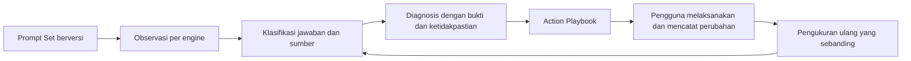

# CiteScout GEO action loop — draft diskusi

Dokumen ini merupakan catatan eksplorasi. Scope revisi telah disetujui pengguna; [implementation plan canonical](../docs/plans/2026-10-10-2109-feat-geo-action-loop-plan.md) menjadi acuan implementasi dan mengatasi usulan yang masih terbuka di bawah.

10 Oktober 2026. Dokumen kerja untuk interview produk. Pengguna telah memilih founder/tim marketing sebagai pengguna utama sekarang; agency dan brand/e-commerce menyusul. Action Playbook tahap awal menyediakan tugas, checklist, dan brief spesifik; pengguna melaksanakannya di website/tools sendiri. Microsoft Copilot tahap awal adalah Copilot Answers di Bing. Dashboard memakai layout campuran ringkasan/tren A dan pekerjaan/bukti B. Monitoring manual serta otomatis harian berjalan untuk engine yang dipilih user. Scope tambahan, satu proyek/account dan manual fresh dalam quota/cooldown sudah disetujui; besaran harga/kuota menunggu evaluasi biaya.

## Tujuan

Pengguna dapat melihat perubahan visibilitas brand, meninjau bukti, memilih pekerjaan konkret, mencatat pelaksanaannya, dan mengukur ulang prompt yang sama.

Pengguna utama fase awal: founder dan tim marketing yang mengoptimasi brand sendiri. Agency SEO/GEO dan tim brand/e-commerce ditunda sesuai pilihan pengguna. Keputusan ini tidak menetapkan dukungan akun bersama, jumlah proyek, atau workflow publikasi otomatis; ketiganya masih perlu scope tersendiri.



## Temuan repo

- `src/client/App.tsx:683`: workspace aktif memakai `V2Shell`; Overview dan Prompts dialihkan ke Questions.
- `src/client/pages/v2/Workspace.tsx:68`: shell aktif memakai header dengan Questions dan Settings.
- `src/client/pages/v2/Workspace.tsx:466`: scan action masih tersedia di Questions sebagai Check today / Run my baseline, hanya ketika `canScan` atau trial eligible. Keluhan pengguna adalah hilangnya akses Monitor Prompt di dashboard; bukan bukti backend scan telah dihapus.
- `src/client/pages/AppShell.tsx:32`: sidebar lama menyediakan Overview, Prompts, Responses, Billing, Settings. Ini sumber komponen/pola untuk dipakai kembali, bukan alasan mengembalikan backend lama seluruhnya.
- `src/shared/evidence.ts:1`: request context mengunci provider Perplexity dan preset fast; perlu perluasan untuk engine/surface/lokasi/bahasa/device serta capability sumber.
- `src/shared/evidence.ts:19`: sumber, citation links, text parts, dan raw capture sudah ada. Pertahankan pemisahan returned source vs cited source.
- `src/server/v2/scans.ts:87`: pembuatan konteks masih spesifik Perplexity. Klaim quota juga menyebut Perplexity dan batas 10 observasi per proyek per hari.
- `src/domain/insights.ts:119`: panduan sumber lama berbasis domain belum menjadi action lifecycle dengan verification dan remeasurement.
- `docs/citescout-v2-implementation.md`: V2 mempunyai snapshot konteks, history, comparison, durable run items, dan reservation. Jadikan fondasi loop baru.

## Provider dan batas observasi

| Surface produk          | Kandidat akses                          | Ketentuan                                                                               |
| ----------------------- | --------------------------------------- | --------------------------------------------------------------------------------------- |
| Perplexity Agent API    | Integrasi yang sudah ada                | Pertahankan sebagai engine observasi saat ini                                           |
| Google AI Overview      | DataForSEO Google Organic SERP Advanced | Tangani overview absent terpisah dari capture failed; evaluasi `load_async_ai_overview` |
| ChatGPT Search          | DataForSEO ChatGPT LLM Scraper          | Ambil Search-mode capture, bedakan dari model API response                              |
| Copilot Answers di Bing | DataForSEO Bing Organic SERP            | Dipilih pengguna untuk tahap awal; aplikasi chat Copilot ditunda                        |

Observasi menyimpan engine dan surface secara terpisah dari collection provider. DataForSEO adalah collector, bukan answer engine. Simpan prompt asli, query yang benar-benar dikirim, bahasa, lokasi, device, konfigurasi, timestamp dan raw result. Perubahan query tidak boleh diam-diam dianggap observasi prompt yang identik.

Tambahan eksplisit pengguna: dashboard selalu menampilkan bukti observasi nyata—prompt yang benar-benar dikirim, tanggal/jam run, engine, dan kutipan asli dari jawaban engine. Panel bukti pada Overview menampilkan observasi yang sedang dipilih; detail observasi menyediakan jawaban lengkap, sumber, konteks collection, dan unduhan raw envelope. Kutipan berasal dari segmen teks yang disimpan; bukan ringkasan yang dibuat Jev. Setiap metrik/diagnosis mempunyai jalur ke observasi pendukung dan menjelaskan denominator, coverage serta versi metode. Hindari skor 0–100 tanpa definisi dan bukti.

Fondasi V2 sudah menyimpan `raw_response_text`, `request_context_json`, `evidence_json` dan timestamp; raw download mengembalikan parsed provider JSON, bukan byte HTTP asli. Transparency UI tidak boleh memberi label seolah byte envelope asli telah diarsipkan. Jawaban teks asli tersedia melalui text parts, dengan fallback legacy dilabeli sesuai provenance.

Provider capability menyatakan apakah data berisi daftar sumber, keterkaitan citation ke span jawaban, search results, atau hanya reference list. Linkage yang tidak disediakan provider tidak direkayasa.

## State yang diberikan ke Jev

Gunakan jawaban asli dengan ID segmen, prompt intent, identitas dan alias brand, daftar kompetitor, fakta produk yang dapat diverifikasi, sumber dan linkage dari parser, serta hasil page checks bila tersedia. Informasi brand diberikan pada tahap post-processing; tidak disisipkan ke prompt observasi netral.

`page_checks` tidak tersedia berarti unknown, bukan accessible, indexed, atau blocked. Source snippet tidak sama dengan isi halaman penuh. Rekam apakah source yang dibaca berupa snippet atau fetched page.

Hitung URL match, citation linkage, jumlah observasi, delta, latency, dan biaya dalam kode. Jev mengevaluasi semantik. Raw capture tetap dapat dibuka ketika klasifikasi gagal atau belum tersedia.

## Kontrak hasil aplikasi: contoh JSON

Ini contoh envelope aplikasi setelah normalisasi, bukan format respons native Jev. Nilai confidence di bawah ilustratif. Field engine/IDs/version dibuat kode; dimensi semantik berasal dari typed answers Jev; keputusan action berasal dari policy aplikasi.

```json
{
  "schema_version": "geo-diagnosis/1",
  "observation_id": "obs_demo_01",
  "engine": "chatgpt_search",
  "surface": "search",
  "prompt_set_version": 3,
  "classification": {
    "answer_quality": "usable",
    "brand_presence": "present",
    "brand_stance": "neutral_mention",
    "recommendation_fit": "unclear",
    "support_for_brand_claims": "insufficient",
    "has_explicit_selection_reason": false,
    "has_explicit_rejection_reason": false,
    "competitor_recommendation": "present",
    "dimensions": {
      "brand_stance": {
        "choice": "neutral_mention",
        "probabilities": {
          "recommended": 0.04,
          "conditional_recommendation": 0.05,
          "neutral_mention": 0.86,
          "discouraged": 0.02,
          "unknown": 0.03
        },
        "confidence": 0.78
      }
    }
  },
  "source_observations": {
    "parse_status": "complete",
    "linkage_capability": "answer_spans",
    "owned_source_returned": true,
    "owned_source_cited": false,
    "supporting_source_ids": ["source_2"],
    "page_checks": "not_run"
  },
  "diagnoses": [
    {
      "type": "evidence_problem",
      "status": "suspected",
      "reason_code": "missing_support_for_buyer_criterion",
      "evidence_refs": ["answer_segment_3", "source_2"],
      "missing_checks": ["inspect_owned_page_for_buyer_criterion"],
      "next_check_id": "inspect_owned_page",
      "eligible_playbook_ids": ["verify_then_add_buyer_evidence"]
    }
  ],
  "processing": {
    "state": "completed",
    "classifier_model": "pinned-at-implementation",
    "classifier_version": "geo-classifier/1",
    "policy_version": "geo-policy/1",
    "needs_review": true
  }
}
```

### Dimensi dan enum yang perlu divalidasi

| Dimensi                             | Pilihan                                                                                     | Penilai                                                           |
| ----------------------------------- | ------------------------------------------------------------------------------------------- | ----------------------------------------------------------------- |
| Answer quality                      | usable, irrelevant, refusal, incomplete, unknown                                            | Jev + pemeriksaan parsing                                         |
| Brand presence                      | present, absent, ambiguous                                                                  | Matcher exact/alias + Jev untuk disambiguasi                      |
| Brand stance                        | recommended, conditional_recommendation, neutral_mention, discouraged, unknown              | Jev per brand                                                     |
| Recommendation fit                  | meets_criteria, partial_fit, mismatch, unclear, not_applicable                              | Jev dengan fakta brand dan intent                                 |
| Support for brand claims            | supported, insufficient, contradicted, unavailable, not_applicable                          | Jev pada sumber yang benar-benar tersedia                         |
| Explicit selection/rejection reason | probability 0–1                                                                             | Noul; simpan probabilitas native, threshold dipilih dari evaluasi |
| Source role                         | owned, competitor_owned, independent_editorial, review_directory, community, other, unknown | Domain ownership dalam kode; jenis konten semantik Jev bila perlu |
| Diagnosis type                      | retrieval_problem, evidence_problem, recommendation_fit_problem                             | Policy menggabungkan dimensi; lebih dari satu dapat berlaku       |
| Diagnosis status                    | suspected, supported, ruled_out, unknown                                                    | Policy berdasarkan bukti dan checks                               |

Brand presence, rekomendasi, dan citation adalah tiga dimensi terpisah. Posisi penyebutan bukan peringkat rekomendasi. Sentiment positif sendiri belum berarti recommendation.

Jika tidak ada masalah terdukung, `diagnoses` boleh kosong. Jangan memaksa salah satu dari tiga diagnosis. Capture failed, no AI overview, source unavailable, dan low confidence mempunyai state operasional tersendiri.

Jev memakai Choice, Score, dan Noul. Karena pertanyaan dievaluasi independen pada state yang sama, satu pertanyaan tidak boleh bergantung pada hasil pertanyaan lain dalam call yang sama. Kode menggabungkan hasilnya. Simpan probabilities dan confidence per dimensi; confidence bukan bukti diagnosis benar. Jangan menyalin confidence stance menjadi confidence akar masalah.

`evidence_refs` hanya menunjuk segmen/source/check yang sudah tersedia dan tervalidasi. Jika memakai Jev untuk memilih bukti, berikan kandidat ID tertutup; jangan meminta Jev membuat quote/offset/URL bebas. Template aplikasi membuat penjelasan dari reason code dan data yang tervalidasi.

## Diagnosis dan Action Playbook

| Temuan                                                                 | Diagnosis yang layak                                    | Langkah berikut                                                                                                                          |
| ---------------------------------------------------------------------- | ------------------------------------------------------- | ---------------------------------------------------------------------------------------------------------------------------------------- |
| Brand dan owned source tidak terlihat                                  | Retrieval suspected, bukan terbukti tidak terindeks     | Periksa halaman sasaran, akses HTTP, robots/noindex/canonical dan relevansi halaman; cek indeks hanya bila ada data indeks yang sah      |
| Page checks mengonfirmasi halaman sasaran diblokir                     | Retrieval supported untuk hambatan akses yang ditemukan | Perbaiki hambatan yang terverifikasi, verifikasi ulang akses, lalu remeasure                                                             |
| Brand disebut, tetapi alasan/bukti untuk buyer criterion lemah         | Evidence suspected                                      | Inspeksi halaman sasaran terlebih dahulu; bila bukti memang kurang, tambah fakta/hasil/customer proof yang relevan dan bisa diverifikasi |
| Jawaban menyebut data produk lama dan ada fakta terkini yang sah       | Evidence supported untuk konflik yang ditemukan         | Perbarui halaman milik brand dan profil yang dikendalikan; siapkan permintaan koreksi untuk sumber pihak ketiga                          |
| Engine eksplisit menolak brand karena syarat prompt dan faktanya cocok | Recommendation-fit supported untuk mismatch tersebut    | Jika produk memenuhi syarat, dokumentasikan bukti; jika tidak, tandai fit gap dan evaluasi segmen target/produk                          |
| Kompetitor direkomendasikan, brand hanya disebut                       | Evidence atau fit masih perlu checks                    | Bandingkan alasan dan sumber secara spesifik; jangan otomatis menyuruh membuat comparison page                                           |
| Capture gagal atau sumber/linkage kurang                               | Diagnosis unknown                                       | Pulihkan observasi/data sebelum membuat tindakan optimasi                                                                                |

Keputusan pengguna: playbook otomatis menghasilkan tugas, checklist, dan brief spesifik yang ditinjau dan dilaksanakan pengguna di website/tools sendiri. Draft konten siap edit dan publikasi otomatis berada di luar scope tahap awal. App mencatat pekerjaan dan hasil pengukuran ulang; tidak mengubah website atau menghubungi pihak ketiga.

Setiap action menyimpan: diagnosis dan observation IDs, reason code, evidence refs, affected prompt IDs, affected engines, target URL/asset bila terverifikasi, judul konkret, checklist, deliverable, prioritas beserta alasan, estimasi effort, owner, status, completion criteria, change record, completed timestamp, dan rencana measurement.

Tambahan eksplisit pengguna: setiap action mempunyai satu label pekerjaan `web_owned` (UI: Web/Owned) atau `earned_media` (UI: Earned Media). Web/Owned mencakup perbaikan teknis dan konten website sendiri. Earned Media mencakup pekerjaan pada peluang sumber pihak ketiga seperti thread Reddit, profil/review G2, media dan YouTube. Label ini menentukan jenis pekerjaan; source ownership dan source type tetap atribut terpisah agar source pihak ketiga tidak otomatis dianggap editorial endorsement.

Earned Media tasks mengikat target URL, platform, observation IDs dan kaitan sumber terhadap jawaban/kompetitor yang teramati. UI menampilkan jumlah observasi yang mencantumkan sumber dalam periode/engine yang dipilih, dan membedakan returned result dari citation/reference yang terverifikasi. Task berdasarkan sumber berulang menghindari saran generik "posting di Reddit". Jika belum ada bukti source-target yang cukup, action berupa pemeriksaan peluang; jangan mengklaim sumber sering dikutip kompetitor. App menyusun brief; pengguna menjalankan kontribusi, pembaruan profil atau pekerjaan media secara manual.

Contoh action: **Dokumentasikan setup time untuk halaman onboarding SaaS.** Hanya muncul setelah prompt membutuhkan setup cepat, jawaban menggunakan kriteria itu, dan pemeriksaan halaman menunjukkan bukti tersebut belum tersedia. Checklist: cari data setup yang sah; tambahkan scope dan metode pengukuran; tulis bagian yang menjawab kriterianya; catat URL dan waktu publikasi. Done: bukti bisa dibaca dan telah diverifikasi; hasil GEO dinilai terpisah setelah pengukuran ulang.

Prioritas mempertimbangkan kepentingan prompt yang ditentukan user, frekuensi masalah pada observasi sebanding, dukungan bukti, kendali pengguna atas asset, dan effort. Hindari persentase uplift yang tidak mempunyai dasar.

Deduplicate diagnosis lintas prompt/engine menjadi satu pekerjaan untuk asset dan masalah yang sama, dengan daftar bukti terpengaruh. Jangan membuat tiket baru setiap scan.

Lifecycle usulan: suggested → accepted → in_progress → implemented → measuring → evaluated. Outcome measurement: improved, unchanged, worsened, inconclusive. Dismissed dan blocked menyimpan alasan. Menyelesaikan pekerjaan tidak otomatis berarti GEO berhasil.

## Mengukur penurunan dan efek tindakan

Keputusan pengguna: manual monitoring dari dashboard tetap tersedia; monitoring otomatis harian berjalan untuk engine yang dipilih pengguna. Usulan policy: manual check membuat observasi baru bila quota dan cooldown memungkinkan; klik ulang untuk request yang sama tidak menagih ulang; scheduler harian dan manual menggunakan anggaran observasi yang sama. Ini mengubah dedupe harian V2; konsekuensinya harus diperlihatkan saat scope dirangkum. Besaran quota, cooldown dan tarif disusun dari evaluasi biaya, bukan menyalin batas lama ke empat engine.

Penurunan dihitung dari sekumpulan observasi sebanding, tidak dari satu jawaban. Simpan baseline dan follow-up pada engine/surface, prompt version, bahasa, lokasi, device, dan collection configuration yang sama. Perubahan classifier/policy memerlukan reclassification yang sebanding atau label comparison unavailable.

Untuk tiap engine tampilkan recommendation rate, mention rate, verified citation rate bila capability memungkinkan, jumlah sampel dan capture coverage. API failures bukan brand absence. Pada Google/Bing pisahkan overview occurrence rate dari presence di overview yang berhasil ditangkap. Jangan menggabungkan engine tanpa menjelaskan bobot dan denominator.

User mencatat URL/diff/deskripsi perubahan dan publication time. Jadwal follow-up adalah usulan yang menyesuaikan jenis aksi dan recrawl; 72 jam/7 hari/14 hari bukan jaminan efek. Keberhasilan mekanis halaman dan perubahan observasi adalah hasil berbeda. Before/after menunjukkan asosiasi, tidak membuktikan kausalitas.

Tambahan eksplisit pengguna: menyelesaikan action membuat annotation/pin pada grafik tren remeasurement. Pin menyimpan action ID, judul, label Web/Owned atau Earned Media, waktu completion, waktu implementasi yang dilaporkan pengguna bila berbeda, serta affected prompt/engine scope. Pilih pin untuk melihat change record, bukti awal dan follow-up yang sebanding. Default waktu pin adalah completion time; waktu implementasi yang berbeda ditampilkan secara eksplisit. Pertahankan completion event historis ketika task dibuka kembali; perubahan status tidak boleh menghapus catatan tindakan yang pernah dilaporkan.

Pin mengikuti filter prompt/engine dan konteks berversi; tampilkan belum ada follow-up atau data tidak sebanding secara jelas. Garis tren tidak diinterpolasi seolah captures yang gagal merupakan brand absence. Pin adalah catatan perubahan dan korelasi visibilitas, bukan bukti uplift kausal atau ROI finansial. Traffic/conversion/revenue attribution tidak dimasukkan hanya karena kebutuhan action pinning.

## Arah dashboard yang perlu diputuskan secara visual

Sidebar profesional adalah kebutuhan eksplisit. Usulan struktur: Overview, Prompt Sets, Observations, Diagnoses, Action Playbook, Sources & Competitors; Billing dan Settings di bagian bawah. Kelompokkan menu agar tidak terlihat seperti daftar fitur tanpa alur.

Kebutuhan eksplisit lain: tombol Monitor Prompt yang dapat ditemukan langsung dari dashboard. Status kontrol harus menjelaskan akses yang tersedia: start check, view progress, view existing result, atau alasan check belum dapat berjalan beserta langkah berikut. Jangan menghilangkan seluruh jalan ke pekerjaan utama ketika trial selesai atau quota habis. Label dan perilaku akhirnya perlu membedakan check sekali dari jadwal otomatis.

Scan V2 saat ini mengembalikan existing run untuk intent hari yang sama. Memunculkan kembali tombol tidak otomatis menyediakan pengukuran ulang berbayar dalam hari yang sama. Policy remeasurement dan quota baru harus eksplisit sebelum tombol menjanjikan hasil baru.

Overview berisi scope proyek, range tanggal, filter engine, waktu refresh dan scan action; ringkasan visibilitas/coverage; tren; matriks prompt × engine; perubahan utama; dan pekerjaan prioritas. Setiap diagnosis dapat membuka jawaban dan sumber asalnya. Sertakan loading, empty, partial data, error, stale, low-confidence dan mobile drawer.

Pengguna memilih layout campuran: ringkasan/tren A di atas, lalu pekerjaan prioritas dan bukti/brief B. Sidebar profesional dan akses Monitor Prompts dipertahankan. Pertahankan brand assets dan komponen UI yang sudah ada; styling final masih perlu visual review.

Pengguna memilih sketsa visual untuk menilai layout. Dua sketsa statis dibuat di direktori temp `ce-brainstorm-geo-visual-20261010`: A menonjolkan metrik, tren dan matriks prompt × engine; B menonjolkan tugas prioritas dan panel bukti/brief, dengan ringkasan visibilitas dan tabel engine. Keduanya memakai sidebar yang sama dan tombol Monitor Prompts yang terlihat. Angka, brand dan diagnosis contoh fiktif; detail styling bukan keputusan final. Perbandingan awal ada di `screens/001-dashboard-layouts.html`, screenshot di `dashboard-a.png` dan `dashboard-b.png`. Pilihan campuran diterjemahkan ke `screens/002-dashboard-hybrid.html` dan `dashboard-hybrid.png`; matriks detail tersedia lewat Prompt Sets / Observations.

Revisi pengguna menambahkan metadata prompt/run dan original quote pada panel bukti, label Web/Owned dan Earned Media pada tugas, serta completion pins di tren. Sketsa revisi mempertahankan layout campuran yang sudah dipilih di `screens/003-dashboard-evidence-pins.html`, dengan screenshot `dashboard-evidence-pins.png`. Rendering desktop diperiksa tanpa horizontal overflow/page errors. Detail interaksi dan mobile belum diimplementasikan.

## Praktik SaaS yang diterapkan pada produk ini

Pengguna meminta penjelasan dan rekomendasi untuk mengisi gap pengetahuan. Default berikut adalah usulan, bukan keputusan pengguna.

- **Nilai pertama:** onboarding membawa user dari brand dan prompt set ke hasil observasi yang dapat ditinjau dan diagnosis/next check yang berguna. Ukur waktu menuju hasil berguna; signup dan jumlah scan tidak sendiri menunjukkan nilai.
- **Pekerjaan utama mudah ditemukan:** monitoring dan pekerjaan prioritas terlihat dari Overview; rincian teknis dan konfigurasi lanjutan dapat dibuka sesuai kebutuhan. [NN/g progressive disclosure](https://www.nngroup.com/articles/progressive-disclosure/) mendukung menampilkan fitur yang sering diperlukan di lapisan utama.
- **Dashboard membantu keputusan:** ringkasan perubahan, cakupan data dan prioritas aksi dihubungkan ke bukti. Tabel mendukung filter, perbandingan, detail dan tindakan; [NN/g data tables](https://www.nngroup.com/articles/data-tables/) menguraikan tugas-tugas tersebut.
- **Aksi punya hasil kerja:** pengguna telah memilih tugas/checklist dan brief spesifik yang dikerjakan founder/marketing di website/tools sendiri; draft konten dan publikasi otomatis ditunda.
- **Alasan untuk kembali:** user melihat pengukuran ulang pada pekerjaan yang telah diimplementasikan, kemudian menentukan langkah berikut. Ukur accepted/implemented actions dan kembali untuk meninjau follow-up, tanpa menganggap perubahan observasi sebagai kausalitas terbukti.
- **Fondasi GEO:** playbook AI Overview memprioritaskan akses crawl/index, konten yang membantu dan fakta yang jelas. Google menyatakan tidak ada persyaratan teknis khusus tambahan atau schema khusus untuk muncul di fitur AI; jangan menjadikan llms.txt/schema sebagai obat default. [Google Search Central](https://developers.google.com/search/docs/appearance/ai-features).

## Urutan implementasi awal — belum menjadi plan final

1. **Kunci product contract dan arah dashboard.** Putuskan pengguna utama, batas otomasi, target Copilot, kuota/cadence dan referensi tampilan. Tunjukkan arah dashboard sebelum mengubah halaman utama.
2. **Pulihkan app shell dan Overview memakai data V2.** Pakai pola sidebar/responsive navigation yang sudah ada; pertahankan history dan billing V2; jangan menghidupkan backend lama sekadar demi tampilannya.
3. **Perluas kontrak observasi dan provider.** Engine/surface/capabilities/context snapshots, reservation dan biaya per task, task submission/polling untuk collector async, status per engine dan additive migration. Integrasikan AIO dan ChatGPT Search; cakupan Copilot mengikuti keputusan surface.
4. **Bangun klasifikasi/diagnosis Jev.** Pinned model + rubric version, validated typed outputs, finite candidate evidence, async post-processing, cached result per input/rubric/model, bounded retries dan unknown fallback. Capture tidak diulang hanya karena classifier gagal.
5. **Selesaikan satu loop action end-to-end.** Diagnosis → template konkret → acceptance → implementation record → comparable follow-up → outcome. Tambahkan source inspection/checks yang diperlukan untuk diagnosis, bukan crawler umum tanpa batas.
6. **Lengkapi dashboard GEO dan validasi pilot.** Diagnosis list, action queue, evidence drawer, engine coverage/trends, comparison dan biaya. Rollout memakai preview dan migration review sesuai workflow repo.

Checks implementation yang bernilai: preservasi history pada migration; neutral observation prompts; mixed engine failure dan quota races; source/citation capability; prompt context comparability; classifier timeout/malformed answer; unsupported root-cause diagnosis; negated/conditional recommendation; dedupe action; tenant ownership; completion vs outcome; keyboard/mobile navigation. Eval Jev memakai observasi yang dilabeli manusia, per dimensi dan per engine, termasuk unknown/OOD. Ukur latency p50/p95 serta biaya per observasi nyata.

Kuota README lama 350 calls/bulan tidak cukup untuk 10 prompt × 4 engines × 30 hari = 1.200 observation tasks, sebelum retries dan page checks. Pricing/cadence perlu diputuskan sebelum multi-engine default dijanjikan.

## Pertanyaan interview

Terjawab: founder/tim marketing lebih dahulu; agency SEO/GEO dan brand/e-commerce belakangan.

Terjawab: belum banyak fitur hilang karena produk masih awal; contoh konkret adalah hilangnya akses tombol Monitor Prompt dari dashboard. Pengguna meminta rekomendasi berdasarkan praktik SaaS yang mapan, bukan harus menyusun semua kebutuhan sendiri.

Terjawab: Action Playbook tahap awal berupa tugas, checklist, dan brief spesifik; pengguna mengerjakan perbaikan di website/tools sendiri.

Terjawab: Copilot Answers di Bing lebih dahulu; aplikasi chat Microsoft Copilot ditunda.

Terjawab: pengguna memilih sketsa visual kasar di browser.

Terjawab: layout campuran dengan ringkasan/tren A dan pekerjaan serta bukti B.

Terjawab: manual + otomatis harian untuk engine yang dipilih pengguna.

Pengguna merevisi checkpoint dengan tiga kebutuhan: transparency prompt/timestamp/raw text; playbook Web/Owned vs Earned Media; action pins pada tren remeasurement. Ketiganya masuk scope dan rangkuman revisi disetujui dengan jawaban "gas". Manual fresh check dalam quota/cooldown dan satu proyek/account mengikuti app saat ini diterima; harga/kuota final ditetapkan sesudah biaya nyata diukur.

## Sumber primer, diperiksa 10 Oktober 2026

- [TypeSafe introduction](https://docs.typesafe.ai/introduction): typed questions; atomic decisions; parallel independent evaluation.
- [TypeSafe quick start](https://docs.typesafe.ai/introduction/quickstart): native Choice/Score/Noul request/response.
- [TypeSafe launch post](https://typesafe.ai/blog/introducing-system-one-models-and-jev): klaim vendor latency end-to-end 70–500 ms. Target kurang dari 50 ms belum terverifikasi untuk aplikasi ini.
- [Google Organic SERP Advanced](https://docs.dataforseo.com/v3/serp/google/organic/live/advanced/): AIO elements dan opsi asynchronous loading.
- [ChatGPT LLM Scraper overview](https://docs.dataforseo.com/v3/ai_optimization-chat_gpt-llm_scraper-overview/): ChatGPT Search capture; Standard/Live task lifecycle.
- [Bing Copilot Answers](https://dataforseo.com/help-center/accessing-data-from-new-elements-of-bing-copilot-ai-overviews): Copilot answer elements di Bing SERP; bukan verifikasi aplikasi chat Copilot.
- [BuzzStream prompt-type citation study](https://www.buzzstream.com/blog/ai-citation-prompt-type-study/): studi primer sekitar 4 juta citations dari 3.600 prompts, empat surface, sepuluh industri, satu minggu mulai 27 Januari 2026. Angka sekitar 40% owned / 60,15% earned berlaku pada slice brand awareness dalam studi ini, bukan rasio universal semua prompt/engine. Studi tidak mencakup Perplexity dan Bing Copilot yang akan dipakai produk ini. Gunakan sebagai alasan memeriksa source mix per proyek, bukan bobot diagnosis atau prioritas tetap.
